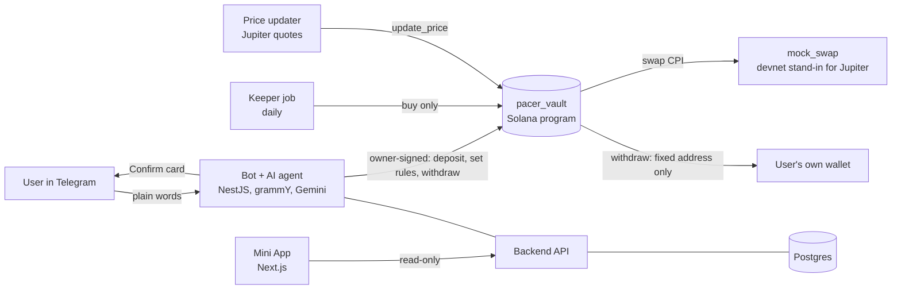

# Pacer

**Save at your pace.** Pacer is an AI agent in Telegram that puts the USDC you already hold into tokenized US stocks (Apple, Nvidia, the S&P 500), a little each day. A Solana program holds the money and enforces the pace. The agent can only buy; money can only leave to the user's own wallet.

Built first for young Nigerians whose naira savings kept losing value. It works for anyone holding USDC outside the US.

> **This is a hackathon demo on Solana devnet.** It uses test money and stand-in stock tokens priced from real market quotes. No real money is involved. Not available to US users. Nothing here is financial advice or a promise of returns. See [What is real, and what isn't](#what-is-real-and-what-isnt).

Built for the MLH Solana Hackathon, November 2026 (AI track).

| | |
|---|---|
| Bot | [@PacerFinanceBot](https://t.me/pacerfinancebot) |
| Mini App | https://miniapp-pacer.vercel.app (open it from the bot to see your own vault) |
| Backend API | https://pacer-api-prod.up.railway.app (`/health`) |
| Source of truth | [`SPEC.md`](SPEC.md) |

## What it does

1. **Say what you want, in plain words.** "Put ₦300 a day into Apple and the S&P." English or Pidgin. The AI agent turns it into a plan and shows a Confirm card. Nothing happens until you confirm.
2. **Deposit once.** Send USDC to your Pacer address. It is moved straight into your vault, a Solana program only you can withdraw from.
3. **The agent buys steadily.** Each day your amount unlocks and the agent buys your chosen stocks. You hear from Pacer once a week, not daily.
4. **Check it yourself.** The Mini App shows what ₦20,000 would have become over five years (past performance, with the worst drops beside the gains), your vault, recent buys, and the rules the agent can't break, read live from Solana.
5. **Take it out any time.** "Withdraw everything" sends your USDC and stock tokens to the wallet you named at setup, in one transaction.

Bot commands: `/start`, `/deposit`, `/balance`, `/status`, `/pause`, `/resume`, `/withdraw`, `/faucet` (test USDC, devnet only), `/about`, `/help`. Plain messages work too.

## Why you can trust the agent with a wallet

The point of Pacer is that the AI agent is **limited by the program, not by our server**. Three keys each do one job:

| Key | Can | Cannot |
|---|---|---|
| **Keeper** (the AI agent) | Buy approved stocks, at the user's pace, within a price check | Withdraw, send, or change anything else. The program refuses |
| **Oracle** | Write prices | Buy or withdraw |
| **Owner** (the user's vault key) | Deposit, change the pace (up to a ceiling), withdraw | Send money anywhere except the fixed withdrawal address |

The withdrawal address is fixed when the vault is created and can't change. Even with our server compromised, nobody can take the money out of a vault to another address.

You can watch this happen: `bun run prove:keeper` (in `backend/`) uses only the agent's key to try three things it must never do, buy faster than the pace, accept almost any price, and withdraw to itself, and shows the program refusing each one on devnet, with Explorer links. Then it makes one ordinary buy that succeeds.

The language model never speaks to the user and never signs anything. Its output is validated against a schema before any action; it can only read, or propose a plan that waits for a Confirm tap. Messages containing a Solana address are never sent to the model.

## How it fits together



- **`pacer_vault`** (Anchor): holds each user's USDC and stocks; enforces pace, allowlist, slippage and price freshness; pays out only to the fixed address.
- **`mock_swap`**: a devnet stand-in for Jupiter that swaps USDC for stand-in stock tokens at the oracle price. On mainnet this would be a real Jupiter route.
- **Backend** (NestJS): the Telegram bot, the AI agent, the keeper that buys each day, the price updater, the weekly summary, and the read-only API the Mini App uses.
- **Mini App** (Next.js): one read-only screen. It never signs and holds no keys.
- **Lander** (Next.js): the public page.

## Repository layout

```
programs/        Anchor programs: pacer_vault, mock_swap; IDLs; devnet deployment manifest
tests/           LiteSVM program tests (its own Cargo workspace)
backend/         NestJS: bot, agent, keeper, prices, history, API (Prisma + Postgres)
miniapp/         Telegram Mini App (Next.js)
lander/          Landing page (Next.js)
data/history/    Monthly NGN/USD, S&P 500, Apple, Nvidia data used for the comparison
docs/            Bot message copy, backend review notes, design specs and plans
SPEC.md          Single source of truth: product, design, risks, demo script
CONTRACT.md      The program's interface: accounts, PDAs, instructions, errors, events
.railway/        Railway config as code; Dockerfile.backend builds the backend image
```

Each folder is its own project with its own `bun.lock`. There is no workspace. **Bun installs, Node runs**: use `bun install` and `bun run <script>`, but Node executes everything, because the Solana and Anchor libraries aren't reliable on Bun's runtime.

## Run it yourself

Prerequisites: Node 22+, Bun, and Postgres. For the programs: Rust (pinned in `rust-toolchain.toml`), Anchor 1.2.2 and the Solana CLI.

### Backend

```bash
cd backend
cp .env.example .env     # then fill it in; never commit it
bun install
bunx prisma generate
bun run prisma:deploy    # needs DATABASE_URL
bun run start:dev
```

Required to run hosted: `DATABASE_URL`, three **different** keys (`KEEPER_SECRET_KEY`, `ORACLE_SECRET_KEY`, `GAS_SECRET_KEY`), `WALLET_ENCRYPTION_KEY` and `TELEGRAM_BOT_TOKEN`. Everything else has a default or is optional; `.env.example` explains each variable. With `GEMINI_API_KEY` or `LLM_MODEL` blank the AI model is off and a deterministic parser handles every message.

- **One bot process per token.** The bot uses Telegram long polling, so a second instance (a local one while Railway runs, say) causes `409` conflicts. Run exactly one.
- **No chain needed for development:** set `VAULT_CLIENT=fake` to use an in-memory vault. Without it, a failure to build the real Solana client stops the app on purpose.
- **Demo settings:** the devnet deployment uses a 10-second "day" and a $0.10 minimum buy. Those are set on-chain and can't be changed, so `PERIOD_SECONDS` and `MIN_TRADE_MICRO_USDC` must match.

Useful scripts (in `backend/`):

| Command | What it does |
|---|---|
| `bun run test` | Unit tests |
| `bun run typecheck`, `bun run lint` | Checks |
| `bun run build && bun run verify:devnet` | The whole loop on devnet with a fresh owner: faucet, create vault, deposit, prices, keeper buy, keeper refused on withdraw, withdraw everything in one transaction |
| `bun run build && bun run prove:keeper` | The agent-key proof described above (`--dry-run` only reads) |
| `bun run eval:llm` | Scores the parser and the AI agent on a set of example messages (needs a Gemini key) |
| `bun run sync:idl` | Copies the generated program IDL into the backend |

### Programs

```bash
anchor build
cargo test --manifest-path tests/Cargo.toml
```

**Read the build output.** A "stack frame overflows the maximum allowed" line is only a warning, but it corrupts memory and shows up later as a nonsense panic. The tests load `target/deploy/*.so`, so rebuild after any program change.

### Mini App

```bash
cd miniapp
bun install
bun run dev              # http://localhost:3000
```

Set `NEXT_PUBLIC_API_URL` to the backend's URL and `NEXT_PUBLIC_BOT_URL` to the bot link. Add `?mock=1` to preview with sample data and no backend. The comparison works in a normal browser; the vault section needs Telegram's login, so open it from the bot. Details: [`miniapp/README.md`](miniapp/README.md).

### Landing page

```bash
cd lander
bun install
bun run dev
```

Details: [`lander/README.md`](lander/README.md).

## Devnet deployment

Public addresses (from [`programs/deployments/devnet.json`](programs/deployments/devnet.json)):

| | Address |
|---|---|
| `pacer_vault` | `Bj6PUUzuupGFKhLdDpVEakW4NQp3z9VXjSmekmx1yHC4` |
| `mock_swap` | `E3fu6bCTnhotjprKFa5kaCgF1avv3n7J1nuB9iPrUFgY` |
| Config account | `874f7x9SLytBSQ992AoaDR4zVnhcJiguVfhBr8CvX8iF` |
| USDC-dev (6 decimals) | `4tsZ3TPVDHoaqvuzQvvwVp5yM2aNGTftEo3Hpteu6ZMN` |
| AAPLx-dev (8 decimals) | `E7wjvbCA2Nkybck3TX8UWHRikMEfEtdDmRnRDjce58rB` |
| NVDAx-dev (8 decimals) | `9NVPUdetoqkQfhWKJnoAm1LoxdRadL2KQ8eqbbZMqztC` |
| SPYx-dev (8 decimals) | `HwjCBrhRkjfifM7aQ4eP4vj7h9mQsVELXjDxmdv5nk6M` |

The stand-in stocks copy the real xStocks' token extensions (permanent delegate, pausable, ScaledUiAmount, transfer hook, freeze authority), so the vault is tested against the real account layout.

The backend deploys to Railway (`Dockerfile.backend` from the repo root, one replica, health check at `/health`); the Mini App and landing page deploy to Vercel with their folder as the root directory.

## What is real, and what isn't

Said plainly, because the guarantees only mean something if the limits are clear.

- **Devnet, not mainnet.** USDC-dev and the stock tokens are stand-ins with no value. Prices are copied from live mainnet xStocks quotes. Jupiter and xStocks exist only on mainnet, so the swap is a mock that reads those prices.
- **The issuer keeps its powers.** Real xStocks are issued by Backed Finance, whose tokens have a permanent delegate, a freeze authority and a pause. So the promise is "neither we nor the agent can take your money", not "nobody can".
- **Deposits are briefly custodial.** USDC arrives at a deposit wallet whose (encrypted) key the server holds, and is moved into the vault within seconds. The vault owner key is also server-held in this demo.
- **Withdrawals arrive in kind.** Your USDC arrives as USDC and your stocks as stock tokens. Selling them is a swap in your own wallet; the vault can't sell for you yet. Selling inside the vault would need a new owner-only `sell` instruction.
- **Eligibility is unconfirmed.** xStocks are not for US users, and eligibility in Nigeria hasn't been confirmed.
- **No advice, no forecasts.** The agent explains options and shows past performance. It never recommends a trade or promises a return. The naira figures use the parallel-market rate from news reports, which is approximate.

The full list of risks and judge questions is in [`SPEC.md`](SPEC.md).

## Documentation

- [`SPEC.md`](SPEC.md): product, design, rules for agents, risks, the 2-minute demo script.
- [`CONTRACT.md`](CONTRACT.md): the vault program's interface.
- [`docs/bot-messages.md`](docs/bot-messages.md): every message the bot sends.
- [`docs/superpowers/`](docs/superpowers/): design specs and implementation plans (the landing page).
- [`data/history/README.md`](data/history/README.md): sources and caveats for the comparison data.

## Working on this repo

Changes go in through pull requests; nothing is merged without review. Each agent or contributor works in its own git worktree on its own branch. `backend/`, `miniapp/` and `lander/` each have an `AGENTS.md` with their rules; read it before changing anything there. Never commit a filled `.env` or any key.
